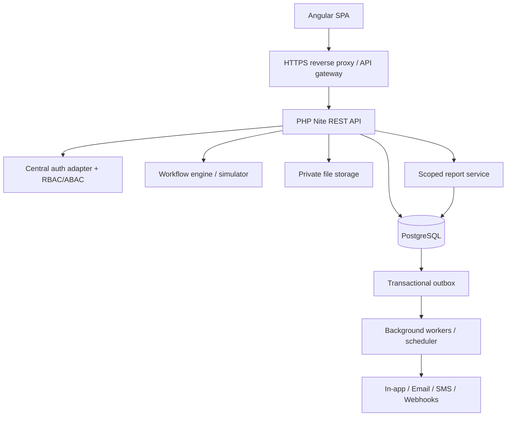

# 07 — Suggested technical architecture

## Components
**Angular:** standalone components per repo conventions, lazy route chunks, typed API client, auth guards for UX only, resilient loading/error states, accessible stage tracker and wizard; no permission logic as source of truth.
**Nite/PHP:** discover actual controller/router/DI conventions before implementation. Use service layers for Ticket, Assignment, WorkflowDefinition, Runtime, SLA, CC/Participants, Audit, Reports and Admin. Parameterized PDO/driver query builder; structured API errors.
**PostgreSQL:** consistent transactions, normalized org/authorization tables, JSONB custom fields/workflow definitions validated on publish and intake, indexes on ticket scope and queues, append-only events/outbox, regular maintenance.
**Background jobs:** notifications, SLA scan, search index refresh, security scanning, scheduled reports, digest and retention. Redis is optional; use Postgres-backed job/outbox first if HRMS practices allow.
**Files:** private S3-compatible store or private protected bind path, metadata in DB, virus scanning, authorized short-lived downloads, quota and retention.
**Integration:** approved identity/SSO/nAuth when actual local integration is verified; HR data import with reconciliation; optional email/SMS gateways; internal API calls with service auth; avoid mixing secret keys between systems.

## Deployment reference
See `deploy/compose.example.yml`; it provisions isolated PostgreSQL, Nite API **placeholder** service/image and optional worker, not a production-complete HRMS copy. Preserve actual HRMS naming, rootless Docker, SELinux bind contexts, network and proxy only after inspection. Never bind a blank volume over existing production data. Back up before any migration. Use explicit image tags and healthchecks. No public PostgreSQL port; secure credentials through Docker secrets or managed secret store; `env.example` contains placeholders only.

## Reliability and consistency
Ticket state, step state, candidate claim, append-only event and notification outbox are **one database commit**. External calls occur after commit; use idempotency and retry. Use `If-Match` or expected version for concurrent actions. Uploads stage privately and only become linked after successful DB transaction; orphan cleanup job reaps failed upload staging. Never implement distributed 2PC to external email systems.

## Delivery environments
Local, CI test, staging and production. Build once/promote immutable image; separate secrets/DB and immutable static assets. Database migrations run once under deployment lock, are compatible with current/next app versions, and include backup/rollback strategy. Forward-only corrective migrations are preferred for schema/data under real production. Define readiness/liveness checks, structured request IDs and trace spans.

## Main API modules
`/auth/me`, `/directory/...`, `/ticket-categories`, `/tickets`, `/tickets/{id}`, `/tickets/{id}/timeline`, `/tickets/{id}/progress`, `/tickets/{id}/participants`, `/tickets/{id}/attachments`, `/tickets/{id}/tasks`, `/tasks/{id}/claim`, `/tasks/{id}/release`, `/tasks/{id}/actions`, `/workflows`, `/workflows/{id}/versions`, `/workflows/{id}/simulate`, `/workflows/{id}/publish`, `/dashboards/{scope}`, `/admin/scope-grants`, `/audit/events`, `/notifications`.
